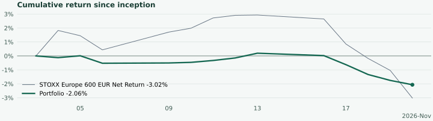
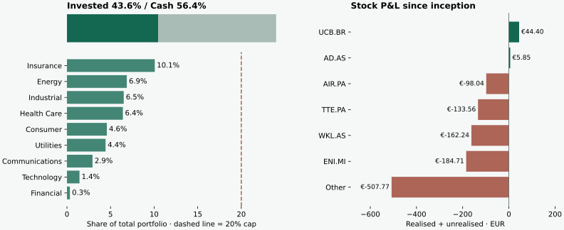

# Euronext Trading Game

I built this strategy for the 2026 Euronext Trading Game on NextWise. Each week, I compare European equities with their sector peers using valuation and profitability z-scores. Price bands around a 100-session moving average guide entries and exits, and inverse volatility determines position size.

I cap target weights at 6% per stock and 20% per sector, then check projected holdings against the 5/10/40 limits before trading.
Each run downloads daily adjusted equity closes from Yahoo Finance. The [benchmark CSV](data/benchmark.csv) contains manually updated STOXX Europe 600 EUR Net Return closing levels from Investing.com. Sector fundamentals come from the [workbook](data/market_data.xlsx). Portfolio results use [executed game trades](data/trades.csv).

## Portfolio dashboard

<!-- portfolio:start -->
**Snapshot at market close · Monday, 23 November 2026** · 14 trading sessions

| Portfolio value | Total P&L | Return since inception |
| ---: | ---: | ---: |
| **€49,139.79** | **−€1,037.11** | **-2.07%** |

| Capital and earnings | EUR | Risk and diversification | Value |
| --- | ---: | --- | ---: |
| Starting cash | €50,000.00 | Annualised realised volatility | 5.14% |
| Starting capital with gift | €50,176.90 | Current drawdown | -2.23% |
| Realised P&L | −€212.98 | Maximum drawdown | -2.25% |
| Unrealised P&L | −€824.13 | Stock HHI | 858.75 |

<!-- portfolio:end -->

Stock HHI measures issuer concentration on a 0–10,000 scale using each security’s share of invested assets. Cash is excluded. Drawdowns are measured from the running peak of the portfolio return index.

---

**Simone D’Onofrio** · [Weekly reports](reports/) · [Strategy code](main.py)
