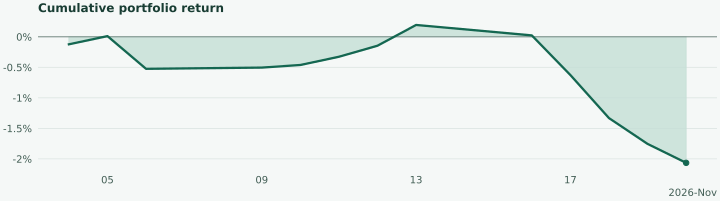

# Euronext Trading Game

Welcome to my page! I present to you my strategy for the Euronext Trading Game 2026 that takes place on the NextWise Platform. The strategy screens Euro equities; starting from their fundamentals, i compute Ratios which then are converted to z-scores. Eligible stocks are then assessed using a 100-session moving average to evaluate their trend and generate signals using lower and upper bands. Risk management relies on inverse volatility sizing. Diversification is assured by a sector cap of 20% and a stock cap of 6%, also following the 5/10/40 rule. Key metrics are Cumulative Returns, Annualized Vol., Drawdown and HHI.

Daily adjusted closes from Yahoo Finance and manually updated company fundamentals feed the [market workbook](data/market_data.xlsx). Portfolio results use [executed game trades](data/trades.csv).

## Portfolio dashboard

<!-- portfolio:start -->
**At the close of 20 November 2026** · 13 trading sessions

| Portfolio value | Total P&L | Return since inception |
| ---: | ---: | ---: |
| **€49,140.83** | **−€1,036.07** | **-2.06%** |

| Capital and earnings | EUR | Risk and diversification | Value |
| --- | ---: | --- | ---: |
| Starting cash | €50,000.00 | Annualised realised volatility | 5.41% |
| Starting capital with gift | €50,176.90 | Current drawdown | -2.25% |
| Realised P&L | −€55.66 | Maximum drawdown | -2.25% |
| Unrealised P&L | −€980.41 | Stock HHI | 793.72 |

<!-- portfolio:end -->

Stock HHI measures issuer concentration on a 0–10,000 scale using each security’s share of invested assets. Cash is excluded. Drawdowns are measured from the running peak of the portfolio return index.

[Weekly reports](reports/) · [Strategy code](main.py)

### Refresh locally

With pandas, openpyxl and matplotlib installed, run `python main.py` after saving the workbook and trade register. Commit the refreshed README and reports with the inputs used for that review.
